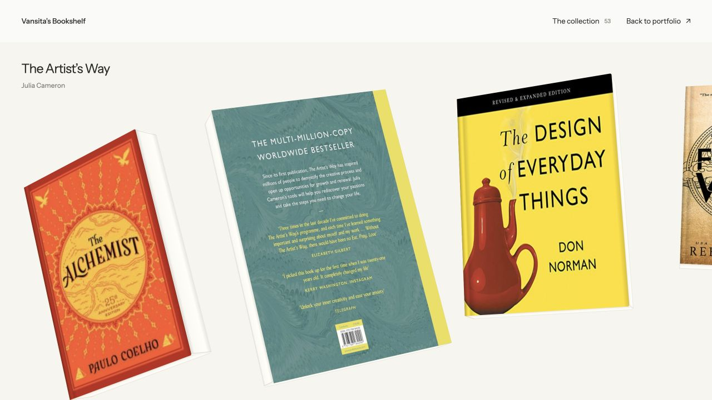

# Personal Digital Library



A reading room for books, thoughts, and words worth keeping. Designed and built by [Vansita Addanki](https://vansita.design).

## The experience

- A curved, draggable book gallery with momentum, keyboard navigation, and reduced-motion support.
- A searchable collection with reading-status and subject filters.
- Grid, list, and shelf views.
- Rotatable book details, reading notes, and a personal vocabulary list called WordLens.
- Reading status, notes, and vocabulary saved in the current browser.

This is a working frontend prototype built with Astro, TypeScript, and CSS. It does not have accounts, a shared database, or cross-device sync.

## Run locally

Use Node.js 22 and npm:

```sh
npm ci
npm run dev
```

Open http://127.0.0.1:4326. The library is available at `/` and `/library`.

```sh
npm run build
npm run preview
```

## Structure

- `src/pages/`: library page markup.
- `src/components/LibraryBook.astro`: physical book appearance.
- `src/scripts/library.ts`: gallery motion, search, filters, details, and browser storage.
- `src/data/library-books.json`: book catalog.
- `src/styles/library.css`: responsive layout and book geometry.
- `public/library/covers/`: cover images.

Browser-saved notes and vocabulary are not included in the source. Book cover imagery belongs to its respective owners and is included for this personal reading project; sources are recorded in `docs/library-cover-sources.json`. Inclusion does not grant reuse rights.
